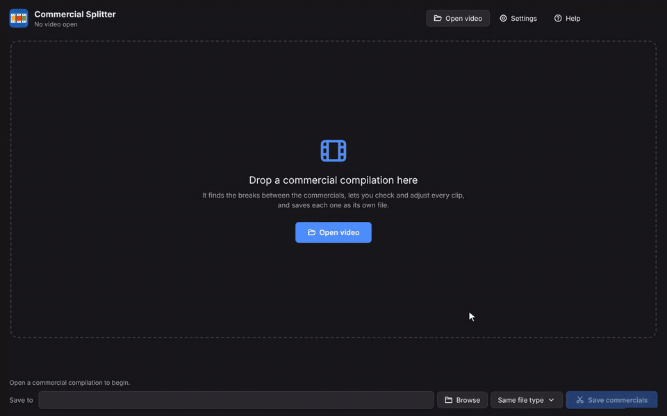
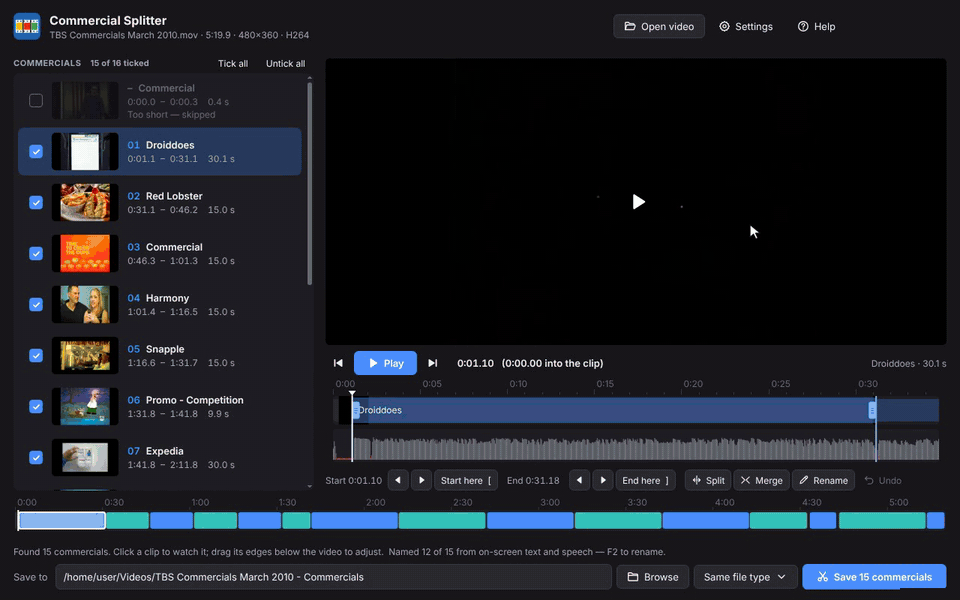
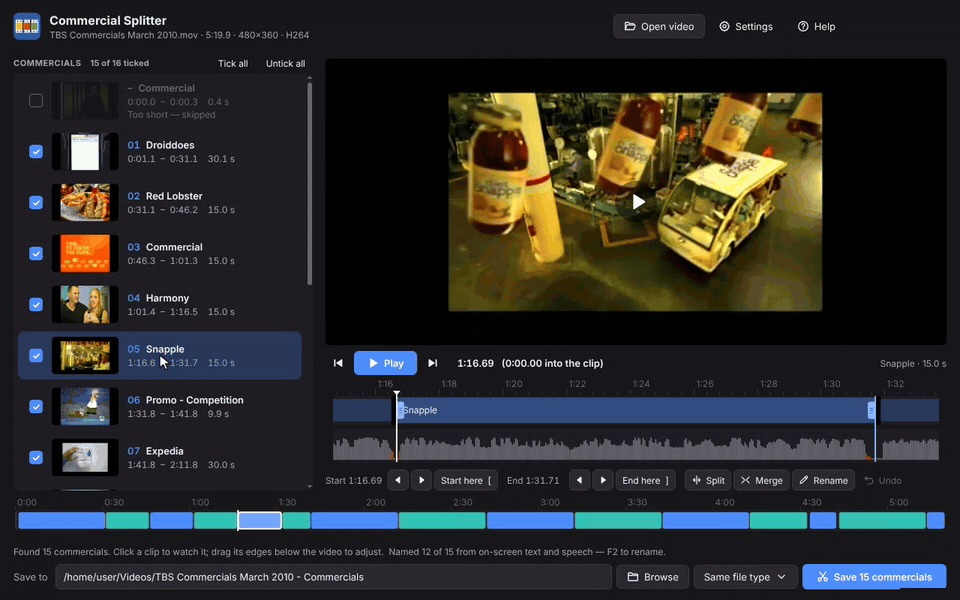
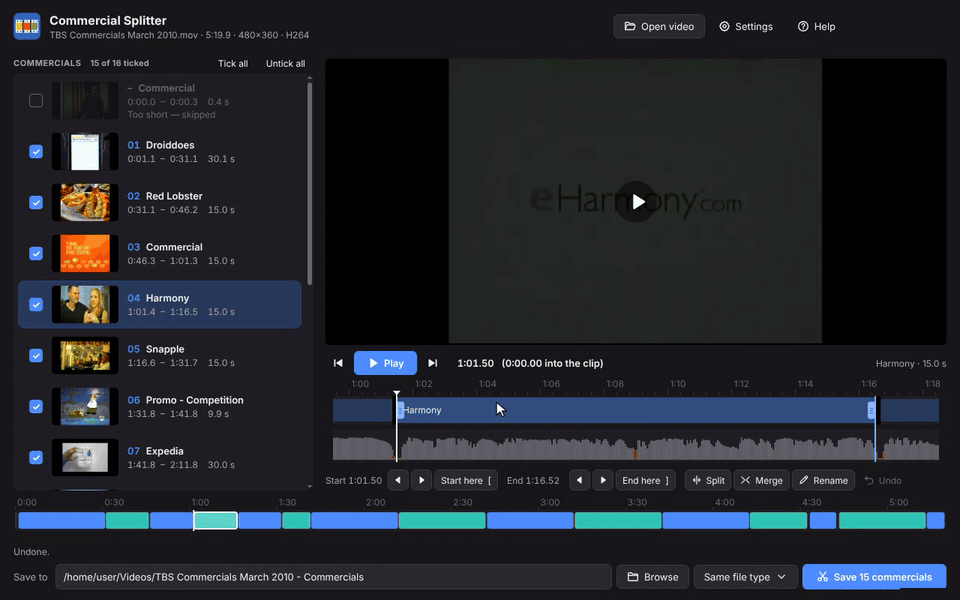
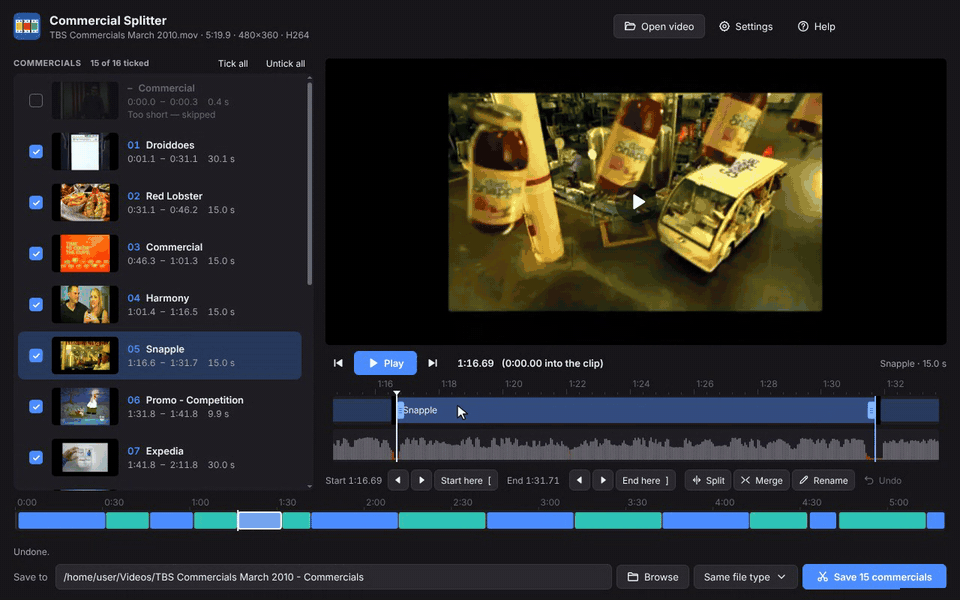
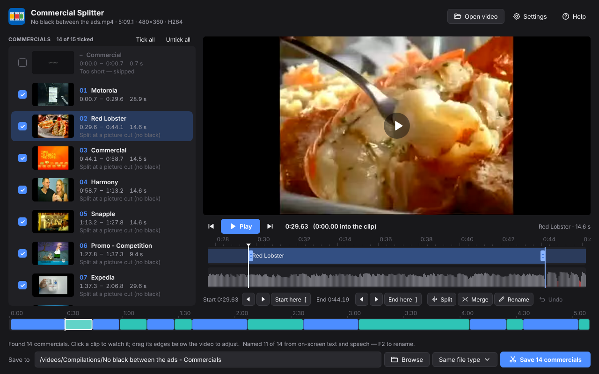
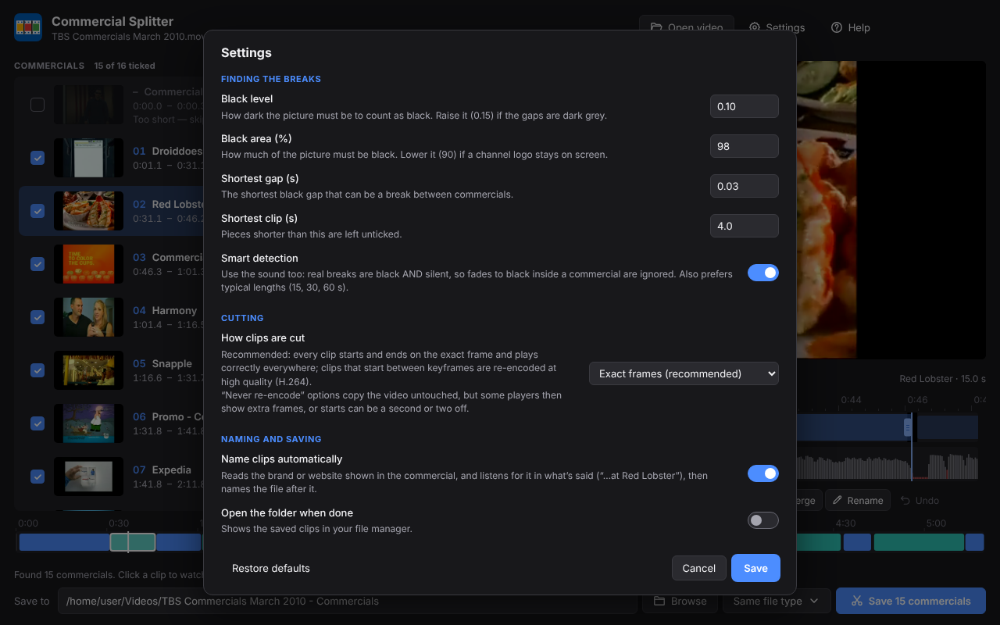
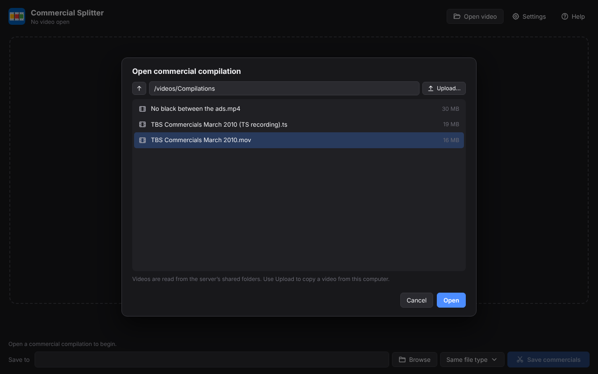
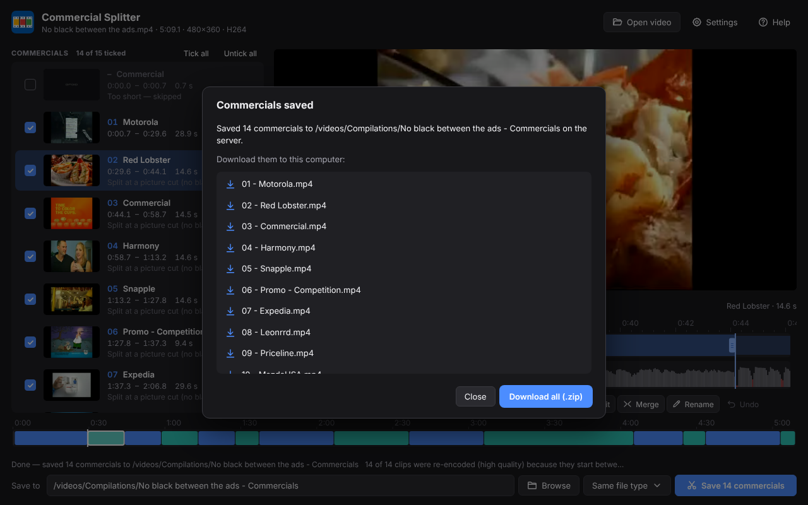
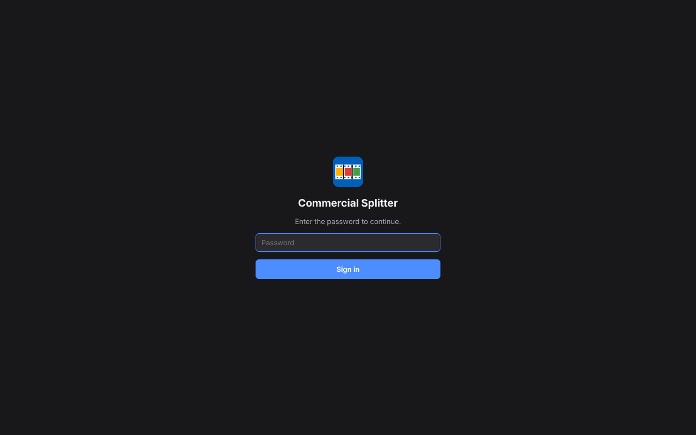

# Commercial Splitter

[](https://github.com/waidan2232/commercial-splitter/actions/workflows/build.yml)
[](https://github.com/waidan2232/commercial-splitter/releases/latest)

Turns a commercial compilation (a recording of a TV ad break, a YouTube compilation…) into **one file per
commercial**, each named after the commercial it contains: `01 - Droiddoes.mov`, `02 - Red Lobster.mov`,
`03 - Reese's.mov`, …

- Finds the breaks between commercials by itself — and ignores fades to black inside a commercial.
- Lets you check every clip in the built-in player and adjust it to the exact frame.
- Names each clip from the brand or website shown on screen and what's said in it.
- Saves clips that start and end on the exact frame and play correctly everywhere.
- The same app on **Windows, macOS and Linux**, or in **Docker** as a web app you use from your browser.
- Works entirely offline: nothing is uploaded anywhere.


## Download

Get the latest version from the [**Releases page**](https://github.com/waidan2232/commercial-splitter/releases/latest):

| System | File |
| --- | --- |
| Windows 10 / 11 | `Commercial-Splitter-…-Windows-Setup.exe` (installer) or `…-win-x64.zip` (no install: unzip and run) |
| macOS, Apple silicon (M1 and later) | `Commercial-Splitter-…-macOS-arm64.dmg` |
| macOS, Intel | `Commercial-Splitter-…-macOS-x64.dmg` |
| Linux | `…-linux-x86_64.AppImage` or `…-linux-amd64.deb` |
| Docker (web app) | `ghcr.io/waidan2232/commercial-splitter` — see [Docker](#docker-web-app) |

Everything is included: FFmpeg, and the text and speech recognition used for naming. The downloads are 240–310 MB
because of that.

**The first time you start it**, the system asks once, because the app isn't signed with a paid certificate:

- **Windows**: "Windows protected your PC" → *More info* → *Run anyway*.
- **macOS**: open the app once; when macOS refuses, go to *System Settings → Privacy & Security* and click
  *Open Anyway*. If macOS says the app "is damaged", run `xattr -cr "/Applications/Commercial Splitter.app"` in
  Terminal and open it again.
- **Linux**: install the `.deb` (`sudo apt install ./Commercial-Splitter-*.deb`), or make the AppImage executable
  (`chmod +x Commercial-Splitter-*.AppImage`) and run it.

## A tour

### Open a compilation

Drag a video onto the window (or click **Open video**). The app scans it — about half a minute for a 35-minute
compilation on a typical computer — and lists every commercial. Then it reads the text on screen and listens to what's said to name
them; you can already watch and edit meanwhile.



### Watch exactly what will be saved

Click a clip and press **Space**: it plays from its first frame and stops on its last one, exactly as it will be
saved. **←** / **→** step one frame, **Shift** + **←** / **→** one second.



### Adjust a clip to the exact frame

The strip below the video zooms in on the selected clip: black gaps are shown in black, and the sound below it —
silence in red. Drag the clip's edges, or play to the right spot and press **[** (start here) or **]** (end here).
The video always shows the frame you're on. **Ctrl+Z** undoes.



### Split a clip that holds two commercials

Click **Split**. Go to the first frame of the second commercial — play, step with the arrow keys, or click one of
the suggestions (★ = most likely: a black screen or a moment of silence, and lengths that make sense) — then click
**Split here**. Clicking a suggestion only moves the video there; nothing is split until you say so.
**Ctrl+B** splits right away at the play position.



### Merge pieces that belong together

Select two or more clips (**Shift**-click) and click **Merge** (**Ctrl+M**). Everything can be undone.



### Name, choose and save

Names come from the screen and the sound ("…at **Red Lobster**"); press **F2** to change one. Untick anything you
don't want, then click **Save**: the clips go into a `<video name> - Commercials` folder next to the video, as
`01 - Name.mov`, `02 - Name.mov`, …


### Commercials without black between them

Some channels cut straight from one commercial to the next, with no black frames. The app finds those joins from
the sound: at a join it usually dips for a moment and the soundtrack changes, while inside a commercial it carries
on across the picture cuts. Typical lengths (15, 30, 60 s) help decide. Here every commercial was found in a
compilation with no black at all (each is marked "Split at a picture cut"):



### Several videos at once

Select or drop several videos and choose **Split them all**: each one is scanned, named and saved with the current
settings, into its own `<video name> - Commercials` folder.

## Keyboard

| Key | Action | Key | Action |
| --- | --- | --- | --- |
| Space | play / pause | ↑ / ↓ | previous / next clip |
| ← / → | one frame back / forward | Shift + ← / → | one second |
| [ | start the clip here | ] | end the clip here |
| Ctrl+B | split at the play position | Ctrl+M | merge |
| F2 | rename | Ctrl+Z | undo |
| Ctrl+O | open a video | Ctrl+S | save |

On a Mac, use ⌘ instead of Ctrl. **Help** in the app has the same list.

## Settings



| Setting | Default | What it does |
| --- | --- | --- |
| Black level | 0.10 | How dark a pixel must be to count as black. Raise it (0.15–0.20) if the gaps are dark grey. |
| Black area | 98 % | How much of the picture must be black. Lower it (about 90 %) if a channel logo stays on screen during the gaps. |
| Shortest gap | 0.03 s | The shortest black gap that counts as a break. |
| Shortest clip | 4 s | Pieces shorter than this are left unticked. |
| Smart detection | on | Uses the sound too: real breaks are black *and* silent, so fades to black inside a commercial are ignored; finds commercials that follow each other without black; prefers typical lengths (15, 30, 60 s). Turn it off to split at every black gap and nowhere else. |
| How clips are cut | Exact frames | See below. |
| Name clips automatically | on | Names the files from the brand or website shown on screen and what's said. |
| Open the folder when done | on | Shows the saved clips in your file manager (in the web version: offers them as downloads). |
| File type (next to Save) | Same as the video | MP4, MKV, MOV or TS are also available. |

**How clips are cut.** *Exact frames* (recommended): every clip starts and ends on the exact frame and plays
correctly in every player and editor. A clip that starts on a keyframe is copied untouched; one that starts between
keyframes is re-encoded at high quality (H.264). *Exact frames, never re-encode*: copies only, and hides the extra
frames before the start with an MP4/MOV start marker, which some players and editors ignore. *Keyframes only*:
copies only, but a clip can only start on a keyframe, so starts can be off by a second or two.

**Good to know.** A commercial that neither shows nor says its brand (music only, a logo without text) stays
"Commercial" — press F2 to name it. If two commercials still end up in one clip, use Split; if one is cut in two,
Merge.

## Docker (web app)

The Docker image serves the same app to any browser on your network — handy on a home server or NAS.

```sh
docker run -d --name commercial-splitter -p 8080:8080 \
  -v /path/to/your/videos:/videos \
  ghcr.io/waidan2232/commercial-splitter:latest
```

Then open <http://localhost:8080> (or `http://<server>:8080` from another computer). Or with Docker Compose: copy
[`docker-compose.yml`](docker-compose.yml), set your video folder, and run `docker compose up -d`.

**Open video** browses the videos folder on the server. **Upload…** (or dragging a file onto the page) copies a
video from your computer to the server first.



The clips are saved on the server, next to the video, and offered as downloads — one by one, or all together as a
.zip:



Set a password with `CS_PASSWORD` if anyone else can reach the port; the page then asks for it:



| Variable | Default | Meaning |
| --- | --- | --- |
| `PORT` | `8080` | Port to listen on |
| `CS_MEDIA_DIRS` | `/videos` | Folders the app may open videos from and save clips to (separated by `:`) |
| `CS_UPLOAD_DIR` | `/videos/Uploads` | Where uploaded videos go |
| `CS_PASSWORD` | – | Ask for this password |
| `CS_DATA_DIR` | `/config` | Where settings are kept |

The app runs as user 1000 in the container. To save clips as your own user, add `--user $(id -u):$(id -g)`.

The image also has the command-line mode:
`docker run --rm -v /path/to/videos:/videos ghcr.io/waidan2232/commercial-splitter cli "/videos/my compilation.mp4"`

## Command line

```
commercial-splitter <video> [--out folder] [--dry-run] [--black-level 0.10] [--black-area 98]
    [--min-gap 0.03] [--min-clip 4] [--format same|mp4|mkv|mov|ts] [--no-smart] [--no-names]
    [--keyframe-cuts] [--marker-cuts] [--reencode-cuts] [--debug] [--json result.json]
```

From source: `node cli.js <video> …`. From the desktop app: start it with `--cli <video> …`.

## Privacy

Everything happens on your computer (or your own server, with Docker): the videos, the scanning, the text and speech
recognition, the saved clips. The app doesn't connect to the internet and collects nothing. Settings are kept in
your user folder.

## Building from source

You need [Node.js](https://nodejs.org) 20 or newer.

```sh
npm ci
node scripts/fetch-ffmpeg.js     # FFmpeg for this computer, into vendor/ffmpeg
node scripts/fetch-models.js     # the speech recognition model, into vendor/models
npm start                        # the desktop app
npm run web                      # or the web version on http://localhost:8080
npm test
npm run dist                     # installers for this system, in dist/
docker build -t commercial-splitter .
```

| Folder | What's there |
| --- | --- |
| `core/` | The engine: scanning (`scan.js`, `audio.js`), deciding where the breaks are (`plan.js`, shared with the interface), saving clips (`cutter.js`), naming (`namer.js`, `speech.js`) |
| `server/` | The back end both versions use: serves the interface and runs the engine |
| `web/` | The interface (plain HTML, CSS and JavaScript) |
| `desktop/` | The Electron shell for Windows, macOS and Linux |
| `test/` | Tests, including end-to-end ones on generated compilations |
| `.github/workflows/` | Builds and tests everything on every push, publishes the Docker image, and a release for each new version |

**Publishing a new version**: change `version` in `package.json` and push to `main`. GitHub Actions builds the apps
for every system, starts each one to check it works, and publishes them as a new release, along with the Docker
image.

## Version history

**6.0** — One app for Windows, macOS, Linux and Docker, with the same interface everywhere. Finds commercials that
follow each other without black frames. Names clips from what's said as well as what's on screen. A clearer Split
panel. Clips from TV recordings (MPEG-TS) no longer start late.

**5** — Windows only. Frame-exact starts and ends, end cards and dark intros kept with their commercial, the built-in
player and clip editor, Merge, Split and Undo, names from on-screen text. (Its source is in the first commit of
this repository.)

## Licenses

Commercial Splitter is MIT-licensed (see [LICENSE](LICENSE)). It includes:

- [FFmpeg](https://ffmpeg.org) (GPL): the desktop apps include static builds (see `resources/ffmpeg/LICENSE.txt` in
  the app); the Docker image uses Debian's package.
- [Tesseract.js](https://github.com/naptha/tesseract.js) and its English language data (Apache 2.0), for reading text.
- [sherpa-onnx](https://github.com/k2-fsa/sherpa-onnx) (Apache 2.0) with OpenAI's
  [Whisper](https://github.com/openai/whisper) tiny.en model (MIT), for speech recognition.
- [Inter](https://rsms.me/inter/) typeface (SIL Open Font License).
- [Electron](https://www.electronjs.org) (MIT).
