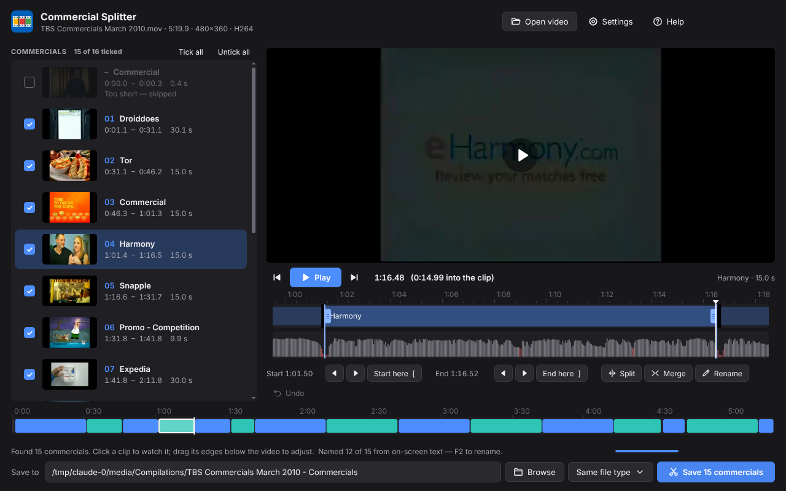

# Commercial Splitter

Splits a commercial compilation (a recording of a TV ad break, a YouTube compilation…) into **one file per
commercial**, and names each file after the commercial it contains — from the brand or website shown on screen and
what's said in it: `01 - Expedia.mov`, `02 - Red Lobster.mov`, …

It finds the breaks between commercials by themselves — the black frames where the sound also drops out — and
ignores fades to black inside a commercial. You can watch every clip in the built-in player, adjust its start and
end to the exact frame, split or merge clips, rename them, and then save them all at once.

The same app, with the same interface, runs on **Windows, macOS and Linux**, or in **Docker** as a web app you use
from your browser.



## Download

Get the latest version from the [**Releases**](../../releases/latest) page:

| System | File |
| --- | --- |
| Windows 10 / 11 | `Commercial-Splitter-…-Windows-Setup.exe` (installer) or `…-win-x64.zip` (no install) |
| macOS (Apple silicon) | `Commercial-Splitter-…-macOS-arm64.dmg` |
| macOS (Intel) | `Commercial-Splitter-…-macOS-x64.dmg` |
| Linux | `…-linux-x86_64.AppImage` or `…-linux-amd64.deb` |
| Docker (web app) | `ghcr.io/waidan2232/commercial-splitter` — see [Docker](#docker-web-app) |

Everything is included (FFmpeg, and the text and speech recognition used for naming). Nothing is uploaded anywhere:
all the work happens on your computer (or your server, with Docker).

**First start.** The app isn't signed with a paid certificate, so the system asks once:

- **Windows**: "Windows protected your PC" → *More info* → *Run anyway*.
- **macOS**: double-click shows a warning → open *System Settings → Privacy & Security* and click *Open Anyway*
  (or right-click the app → *Open*).
- **Linux AppImage**: make it executable (`chmod +x Commercial-Splitter-*.AppImage`) and run it. If your system
  blocks it, use the `.deb` instead (`sudo apt install ./Commercial-Splitter-*.deb`).

## How to use it

1. Drag a video onto the window, or click **Open video**.
2. The app scans the video and lists every commercial, then reads the text on screen to name them. You can watch
   and edit meanwhile.
   - Click a clip to see it, **Space** to play it — exactly what will be saved.
   - Untick anything you don't want.
   - Drag a clip's edges in the strip below the video, or use **Start here** / **End here** at the play position.
   - One commercial cut in two? Select both and click **Merge**.
   - Two commercials in one clip? Play to where the second one starts and press **Ctrl+B**, or click **Split** for
     suggestions (★ marks the likeliest places).
   - Wrong name? Press **F2**.
3. Click **Save**. The clips go into a folder named `<video name> - Commercials` next to the video.

Several videos at once: select or drop several files and choose *Split them all* to process them all with the
current settings.

### Keyboard

| Key | Action | Key | Action |
| --- | --- | --- | --- |
| Space | play / pause | ↑ / ↓ | previous / next clip |
| ← / → | one frame back / forward | Shift + ← / → | one second |
| [ | start the clip here | ] | end the clip here |
| Ctrl+B | split at the play position | Ctrl+M | merge |
| F2 | rename | Ctrl+Z | undo |
| Ctrl+O | open a video | Ctrl+S | save |

(On a Mac, use ⌘ instead of Ctrl.)

### Settings

| Setting | Default | What it does |
| --- | --- | --- |
| Black level | 0.10 | How dark a pixel must be to count as black. Raise it (0.15–0.20) if the gaps are dark grey. |
| Black area | 98 % | How much of the picture must be black. Lower it (about 90 %) if a channel logo stays on screen during the gaps. |
| Shortest gap | 0.03 s | The shortest black gap that counts as a break. |
| Shortest clip | 4 s | Pieces shorter than this are left unticked. |
| Smart detection | on | Uses the sound too: real breaks are black *and* silent, so fades to black inside a commercial are ignored. Also prefers typical lengths (15, 30, 60 s). Turn it off to split at every black gap. |
| How clips are cut | Exact frames | See below. |
| Name clips automatically | on | Names the files from the brand or website shown on screen and what's said ("…at Red Lobster"). |

**How clips are cut.**
*Exact frames* (recommended): every clip starts and ends on the exact frame and plays correctly in every player and
editor. A clip that starts on a keyframe is copied untouched; one that starts between keyframes is re-encoded at
high quality (H.264). *Exact frames, never re-encode*: copies only, and hides the extra frames before the start
with an MP4/MOV start marker, which some players and editors ignore. *Keyframes only*: copies only, but a clip can
only start on a keyframe, so starts can be off by a second or two.

**Good to know.** Commercials that cut straight into each other, with no black frames in between, are found from
the sound: at such a join it usually dips for a moment and the soundtrack changes, while inside a commercial it
carries on across the picture cuts. Typical lengths (15, 30, 60 s) help decide. If two still end up in one clip, use
Split — the ★ suggestions are the likeliest places. Names come from the text on screen and what's said; a
commercial that neither shows nor says its brand (music only, a logo without text) stays "Commercial".

## Docker (web app)

The Docker image serves the same app to any browser on your network — handy on a home server or NAS.

```sh
docker run -d --name commercial-splitter -p 8080:8080 \
  -v /path/to/your/videos:/videos \
  ghcr.io/waidan2232/commercial-splitter:latest
```

Then open <http://localhost:8080> (or `http://<server>:8080`). Or with Docker Compose: copy
[`docker-compose.yml`](docker-compose.yml), adjust the video folder, and run `docker compose up -d`.

- **Open video** browses the `/videos` folder on the server. **Upload…** (or dragging a file onto the page) copies a
  video from your computer into `/videos/Uploads`.
- Clips are saved on the server, next to the video. When they're done the app offers them as downloads, one by one
  or all together as a .zip.
- **Password**: set `CS_PASSWORD=…` and the page asks for it. Do this if anyone else can reach the port.
- **File ownership**: the app runs as user 1000. To save clips as your own user, add `--user $(id -u):$(id -g)`.

| Variable | Default | Meaning |
| --- | --- | --- |
| `PORT` | `8080` | Port to listen on |
| `CS_MEDIA_DIRS` | `/videos` | Folders the app may open videos from and save clips to (separated by `:`) |
| `CS_UPLOAD_DIR` | `/videos/Uploads` | Where uploaded videos go |
| `CS_PASSWORD` | – | Ask for this password |
| `CS_DATA_DIR` | `/config` | Where settings are kept |

The image also has the command-line mode:
`docker run --rm -v /path/to/videos:/videos ghcr.io/waidan2232/commercial-splitter cli "/videos/my compilation.mp4"`

## Command line

```
commercial-splitter <video> [--out folder] [--dry-run] [--black-level 0.10] [--black-area 98]
    [--min-gap 0.03] [--min-clip 4] [--format same|mp4|mkv|mov|ts] [--no-smart] [--no-names]
    [--keyframe-cuts] [--marker-cuts] [--reencode-cuts] [--debug]
```

From source: `node cli.js <video> …`. From the desktop app: run it with `--cli <video> …`.

## Building from source

You need [Node.js](https://nodejs.org) 20 or newer.

```sh
npm ci
node scripts/fetch-ffmpeg.js     # downloads FFmpeg for this computer into vendor/ffmpeg
node scripts/fetch-models.js     # downloads the speech recognition model into vendor/models
npm start                        # the desktop app
npm run web                      # or the web version on http://localhost:8080 (needs FFmpeg on the PATH or in vendor/)
npm test
npm run dist                     # installers for this system, in dist/
docker build -t commercial-splitter .
```

How it's put together:

| Folder | What's there |
| --- | --- |
| `core/` | The engine: scanning (`scan.js`), deciding where the breaks are (`plan.js`, shared with the interface), saving clips (`cutter.js`), naming (`namer.js`) |
| `server/` | The back end both versions use: serves the interface and runs the engine |
| `web/` | The interface (plain HTML, CSS and JavaScript) |
| `desktop/` | The Electron shell for Windows, macOS and Linux |
| `.github/workflows/` | Builds and tests everything; a `v*` tag publishes a release and the Docker image |

To publish a release: update `version` in `package.json`, then `git tag v6.0.1 && git push --tags`. GitHub Actions
builds the installers for every system, tests them, attaches them to a new release and publishes the Docker image.

## Licenses

Commercial Splitter is MIT-licensed (see [LICENSE](LICENSE)). It includes:

- [FFmpeg](https://ffmpeg.org) (GPL; the desktop apps include static builds — see `resources/ffmpeg/LICENSE.txt`
  in the app — and the Docker image uses Debian's package).
- [Tesseract.js](https://github.com/naptha/tesseract.js) and its English language data (Apache 2.0).
- [sherpa-onnx](https://github.com/k2-fsa/sherpa-onnx) (Apache 2.0) with OpenAI's
  [Whisper](https://github.com/openai/whisper) tiny.en model (MIT), for speech recognition.
- [Inter](https://rsms.me/inter/) typeface (SIL Open Font License).
- [Electron](https://www.electronjs.org) (MIT).
